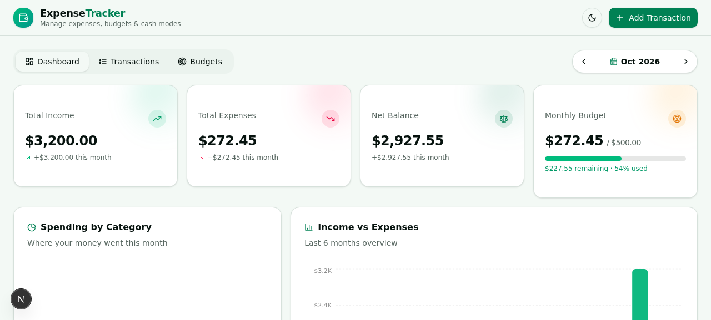
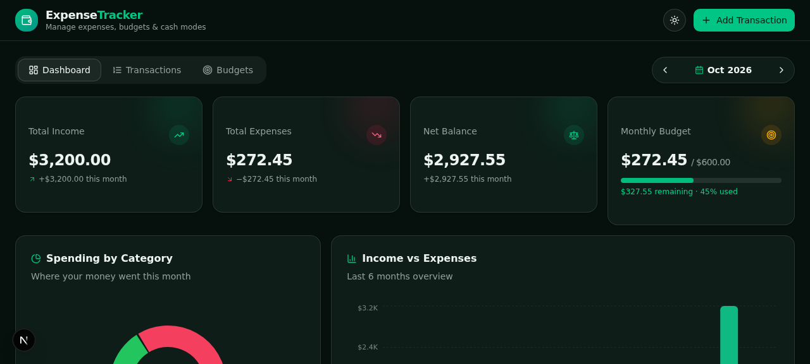
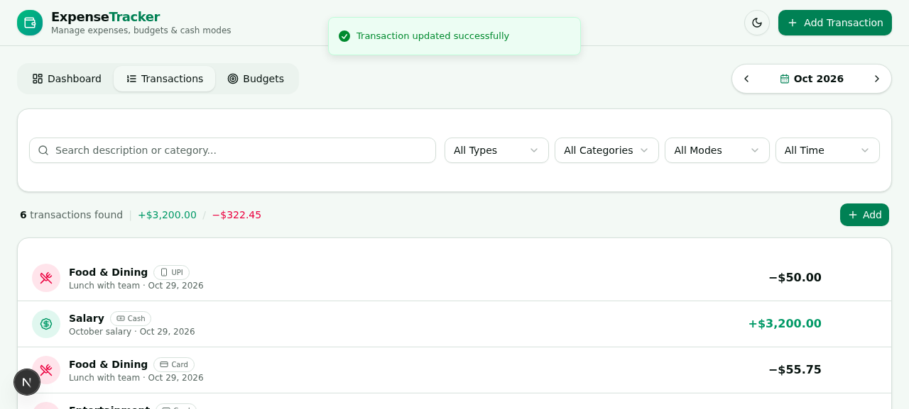
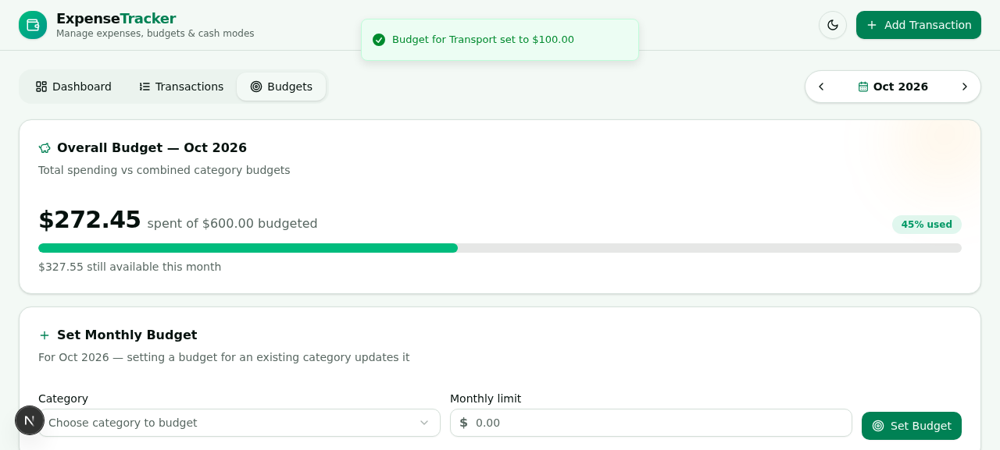

# ExpenseTracker 💰

A clean, fast, and beautiful personal expense tracker built with **Next.js 16**, **TypeScript**, **Prisma (SQLite)**, and **shadcn/ui**.

Track income and expenses, set monthly category budgets, visualize spending trends, and switch between light and dark mode — all in one place.



## ✨ Features

- **➕ Add / ✏️ Edit / 🗑️ Delete transactions** — full CRUD for income and expense entries with validation, toasts, and confirmation dialogs
- **📊 Dashboard** — total income, total expenses, net balance, and monthly budget usage at a glance
- **🎯 Monthly budgets** — set a limit per category per month, with color-coded progress bars (green → amber → red) and over-budget warnings
- **🧾 Transaction history** — searchable, filterable list (by type, category, payment mode, and month) with "show more" pagination
- **💳 Multiple payment modes** — Cash, Card, UPI, Bank Transfer, and Wallet, with a "Cash Modes Used" breakdown panel
- **📈 Charts** — spending-by-category donut chart and 6-month income vs. expenses bar chart (Recharts)
- **🌗 Dark mode** — system-aware theme toggle, persisted across sessions
- **📱 Responsive** — mobile-first layout that scales beautifully to desktop

## 🖼️ Screenshots

| Light | Dark |
| --- | --- |
|  |  |

| Transactions | Budgets |
| --- | --- |
|  |  |

## 🛠️ Tech Stack

| Layer | Technology |
| --- | --- |
| Framework | Next.js 16 (App Router) + TypeScript |
| Styling | Tailwind CSS 4 + shadcn/ui (New York) |
| Icons | Lucide React |
| Charts | Recharts |
| Animation | Framer Motion |
| Data fetching | TanStack Query |
| Database | Prisma ORM + SQLite |
| Notifications | Sonner |
| Theming | next-themes |

## 🚀 Getting Started

### Prerequisites

- [Node.js](https://nodejs.org/) 20+ (or [Bun](https://bun.sh/))

### Install & run

```bash
# 1. Install dependencies
bun install        # or: npm install

# 2. Create the SQLite database and push the schema
bun run db:push    # or: npx prisma db push

# 3. Start the dev server
bun run dev        # or: npm run dev
```

Open [http://localhost:3000](http://localhost:3000) and start tracking!

> 💡 The database URL is read from `.env` — create one with `DATABASE_URL="file:./db/custom.db"` if it doesn't exist.

## 📁 Project Structure

```
src/
├── app/
│   ├── api/
│   │   ├── budgets/        # GET/POST budgets, PATCH/DELETE by id
│   │   ├── transactions/   # GET/POST transactions, PATCH/DELETE by id
│   │   ├── stats/          # aggregated dashboard statistics
│   │   └── route.ts        # health check
│   ├── layout.tsx          # root layout + providers
│   └── page.tsx            # main app shell (tabs)
├── components/
│   ├── finance/            # feature components
│   │   ├── summary-cards.tsx      # income / expense / balance cards
│   │   ├── charts-panel.tsx       # donut + bar charts
│   │   ├── mode-strip.tsx         # payment mode breakdown
│   │   ├── transaction-dialog.tsx # add/edit form
│   │   ├── transaction-list.tsx   # history + filters + delete
│   │   ├── budget-panel.tsx       # budget CRUD + progress
│   │   ├── budget-progress.tsx    # color-coded progress bar
│   │   ├── month-navigator.tsx    # month switcher
│   │   └── category-icon.tsx      # category/mode icon mapping
│   └── ui/                 # shadcn/ui primitives
├── hooks/                  # shared hooks
└── lib/
    ├── finance.ts          # types, categories, formatters
    └── db.ts               # Prisma client singleton
```

## 📄 License

MIT
